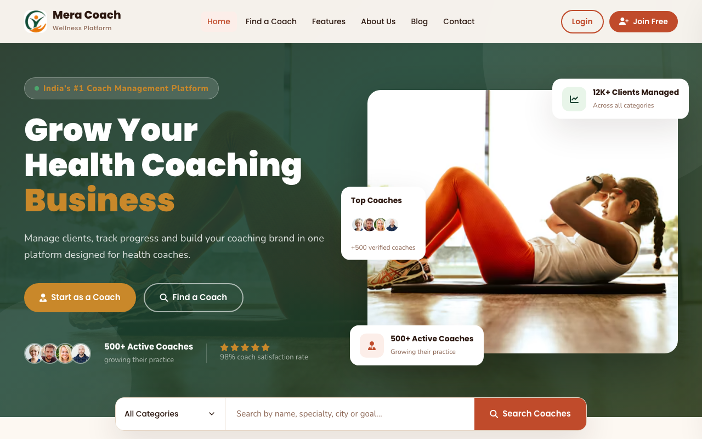
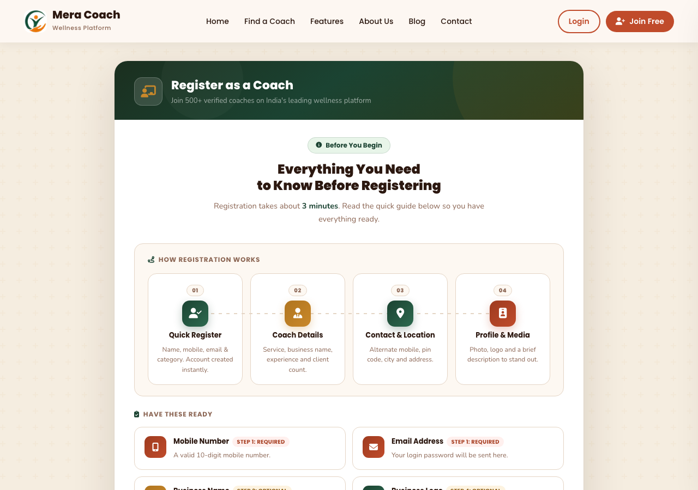
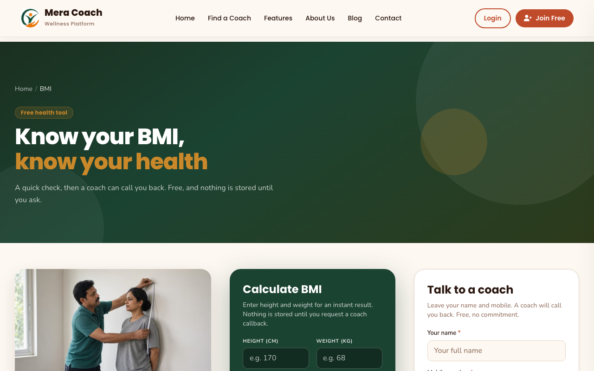
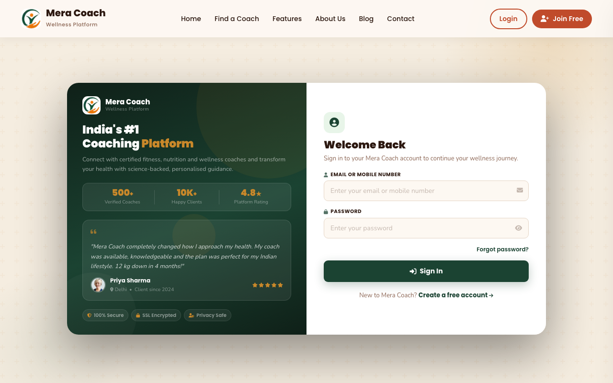
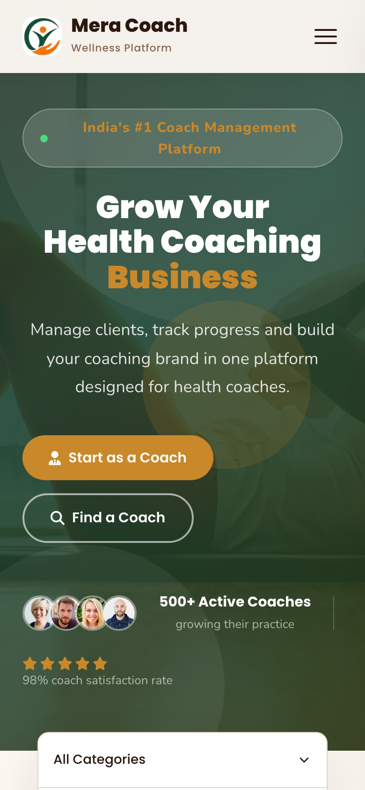

<div align="center">


# Mera Coach Website

**Get found by clients. Run the practice that follows.**

The public face of [mera-coach.com](https://mera-coach.com): visitors find a coach and reach out,
coaches sign up, manage clients and build the profile that brings leads in.


<br />



<sub><b>Home</b> — a coach search from the first screen</sub>

</div>

---

## One site, three journeys

|        | Journey        | What happens                                                                                            |
| ------ | -------------- | ------------------------------------------------------------------------------------------------------- |
| **01** | **Discover**   | Browse the coach directory, filter by category, place and rating, open a profile and send an enquiry     |
| **02** | **Join**       | Register as a coach in about three minutes, then sign in to the dashboard                                |
| **03** | **Run it**     | Dashboard for clients, leads, check-ups, packages, gallery and events, and the public profile            |

Premium plans are bought here with Razorpay. Clients leave feedback here through the link a coach sends them.

---

## Take a look

<div align="center">
<table>
  <tr>
    <td align="center" width="50%">
      
      <br /><sub><b>Register</b><br />A calm four-step start, with what to have ready</sub>
    </td>
    <td align="center" width="50%">
      
      <br /><sub><b>BMI calculator</b><br />A free tool that brings visitors in and passes a lead to a coach</sub>
    </td>
  </tr>
  <tr>
    <td align="center" width="50%">
      
      <br /><sub><b>Coach sign-in</b><br />One sign-in for the dashboard</sub>
    </td>
    <td align="center" width="50%">
      
      <br /><sub><b>On a phone</b><br />Every page is built for a small screen first</sub>
    </td>
  </tr>
</table>
</div>

<p align="center"><sub>Light theme · teal, terracotta and gold on warm white · Poppins, Nunito and Montserrat</sub></p>

> The home page also plays a short tour of the app in a phone frame. It is drawn with HTML and CSS in `src/components/home/app-phone-demo.tsx`, so **update it whenever the app's screens change**.

---

## Pages

| Route                          | What it is                                                                                        |
| ------------------------------ | ------------------------------------------------------------------------------------------------- |
| `/`                            | Marketing home                                                                                    |
| `/coach`                       | Public coach directory with category, place and rating filters                                    |
| `/coach/[name-or-code]`        | A coach's profile and enquiry form. The address is the coach's friendly name, for example `/coach/pradyumma-kumar-health-coach-mathura`. Older links using the coach code still work |
| `/services`, `/bmi`, `/contact`| Services, the BMI calculator with a callback form, and contact                                    |
| `/register`                    | Coach registration                                                                                |
| `/coach-login`                 | Coach sign-in, then `/dashboard`                                                                  |
| `/dashboard`                   | The coach's practice: clients, leads, check-ups, packages, gallery and events, reviews, profile. The bell in the top bar opens the notifications |
| `/premium`, `/premium/success` | Plans and Razorpay checkout, then the confirmation page                                            |
| `/feedback`                    | Client feedback form, opened from a link with `?coachCode=&clientCode=`                           |
| `/forgot-password`             | Password reset                                                                                    |
| `/terms`, `/privacy`           | Legal pages. Have counsel review the wording before launch                                        |
| `/.well-known/assetlinks.json` | Lets links to `/coach-login` open the Android app when it is installed                            |

Utility pages (`/coach-login`, `/forgot-password`, `/feedback`, `/premium`) are `noindex` and disallowed in `robots.txt`. The sitemap lists public pages and coach profiles only.

---

## Quick start

**Need:** [Bun](https://bun.sh) and the Mera Coach API running (see the API's README).

```bash
bun install
cp .env.example .env.local   # then set NEXT_PUBLIC_API_BASE_URL
bun dev                      # http://localhost:3000
```

| Variable                            | Required | Purpose                                                                                       |
| ----------------------------------- | -------- | --------------------------------------------------------------------------------------------- |
| `NEXT_PUBLIC_API_BASE_URL`          | Yes      | API origin, no trailing slash. A production build fails if it is missing or not `https`        |
| `NEXT_PUBLIC_SITE_URL`              | Advised  | Canonical site address for links, sitemap and sharing. Defaults to `https://mera-coach.com`    |
| `NEXT_PUBLIC_IMAGE_HOSTS`           | No       | Extra hostnames for coach photos, such as a CDN. The API origin is allowed automatically       |
| `NEXT_PUBLIC_SUBSCRIPTION_REQUIRED` | No       | `true` puts Add Client behind a premium plan; `false` lets every coach add clients             |
| `NEXT_PUBLIC_PLAY_STORE_URL`         | No       | Google Play listing (`https`). The footer and home buttons open it; until set they show "Coming soon" |
| `NEXT_PUBLIC_APP_STORE_URL`         | No       | App Store listing (`https`). Same as above                                                      |
| `NEXT_PUBLIC_SOCIAL_*`              | No       | Facebook, Instagram, X, YouTube and LinkedIn links. Only the ones you set show in the footer   |
| `ANDROID_APP_SHA256_FINGERPRINTS`   | No       | Play app-signing fingerprints, so the Android app can open `/coach-login` links                |

Support email, WhatsApp, address and hours: edit `src/config/contact.ts`.

**Payment keys never go in the website.** Razorpay's key id and secret live on the API, which sends the website a `keyId` with each order.

| Script               | What it does                                       |
| -------------------- | -------------------------------------------------- |
| `bun dev`            | Dev server (Turbopack)                             |
| `bun run build`      | Production build                                   |
| `bun run lint`       | ESLint and TypeScript                              |
| `bun run type-check` | `tsc --noEmit`                                     |
| `bun test`           | Unit tests                                         |
| `bun run fmt`        | Format with Prettier                               |
| `bun run validate`   | Lint, format check and build, as CI does           |

---

## How it is built

| Layer      | Choice                                                                   |
| ---------- | ------------------------------------------------------------------------ |
| Framework  | Next.js 16 App Router, React 19, React Compiler, Cache Components        |
| Styling    | Tailwind CSS 4 with the app's colours as CSS variables                    |
| API access | One typed client in `src/lib/api/`, one module per feature               |
| Session    | The coach's token is kept in the browser and sent as a Bearer header     |
| Tooling    | Bun · ESLint · Prettier · Husky                                          |

```
src/
  app/                Routes. Server Components unless a page needs the browser
  components/         Site shell, feature components, practice/ (the dashboard), ui/
  config/             Typed env and site settings
  constants/          Shared labels and limits
  lib/api/            API client and one module per feature (coach, premium, showcase …)
  lib/                Auth session, media, coach profile paths, assessment helpers
  styles/             Design tokens and global styles
  types/              Shared request and response types
```

### Packages, gallery and events

- **Packages** (`/dashboard/packages`): the coach picks a brand and its products, which come from the API's product master, then sets each price and an editable total. A category filter narrows the list and a product's suggested price pre-fills. A switch on each package shows or hides it on the public profile.
- **Posts** (`/dashboard/events`): one form with three categories from the API: Gallery (a photo or video with a short tag), Workshop & Event, and Client Success, which needs a client and the coach's consent. Photos upload up to 5 MB and videos up to 25 MB, the same as the API.
- The public profile shows packages, gallery, events and success stories. Success stories appear only with consent and show the client's first name.

### Registration and uploads

Registering returns a short-lived upload token (30 minutes). The form uses it to upload the logo and photo and to save the service details, so no account has open write access before sign-in. Logos and photos can be JPG, PNG or WebP, up to 5 MB.

---

## Before you release

1. Set `NEXT_PUBLIC_SITE_URL` and `NEXT_PUBLIC_API_BASE_URL` (`https`) for production.
2. Make sure the API is the build that matches this site. Routes have no version in them, so an older site build that calls `/v1/...` stops working once the new API is live: deploy them together.
3. Run `bun run validate`.

### Check these by hand

<details>
<summary><b>Register, sharing and error pages</b></summary>

1. **Register:** open `/register`, fill name, mobile and email, and choose a logo and photo. A wrong file type or size shows a banner and does not submit. A good submit creates the coach, uploads each image and saves the links. If an image fails after the account exists, the banner still offers sign-in.
2. **Icons and sharing:** the page source shows the Mera Coach favicons, `/site.webmanifest` uses the brand colour, and the share image is `/mc-images/og-image.jpg` (1200×630). After deploying, test the address in [opengraph.xyz](https://www.opengraph.xyz/).
3. **Errors:** a missing page shows the branded 404, and a broken page shows the branded error screen with Try again. Forms use the site's field style, with the teal focus ring.

</details>

<details>
<summary><b>Premium checkout</b></summary>

1. **Without live keys:** open `/premium?coachId=<id>&coachCode=<code>` (the app builds the same link). Plans load, and Pay asks the API for an order. If the API has no Razorpay keys the banner says so. That is expected; it must never fake a success.
2. **With test or live keys:** complete checkout. The site confirms the payment with the API and then opens `/premium/success`. In the app, pull to refresh the profile and check the period matches.
3. **Failure cases:** missing coach id or code shows a validation banner. An invalid promo shows the API's message. Closing the Razorpay window shows "checkout closed". A failed payment says it was not completed. A bad signature shows an error and no success page.
4. **Plan rules** (renewals, lined-up plans, refunds) are described in the API's README.

</details>

<details>
<summary><b>Find a coach and feedback</b></summary>

1. `/coach`: filter, open a profile and send an enquiry (the API must be running).
2. `/feedback?coachCode=…&clientCode=…`: submit a rating.

</details>

---

<div align="center">


<sub>Built for coaches on <a href="https://mera-coach.com">mera-coach.com</a></sub>

</div>
